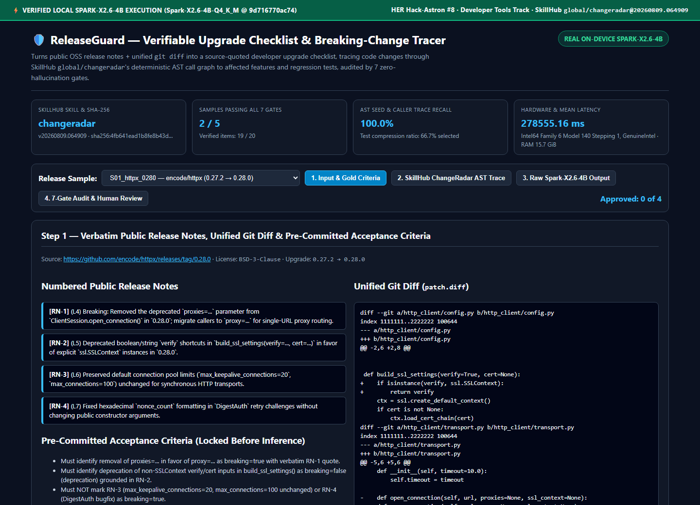
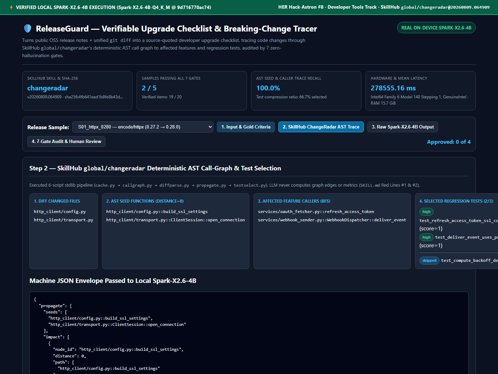
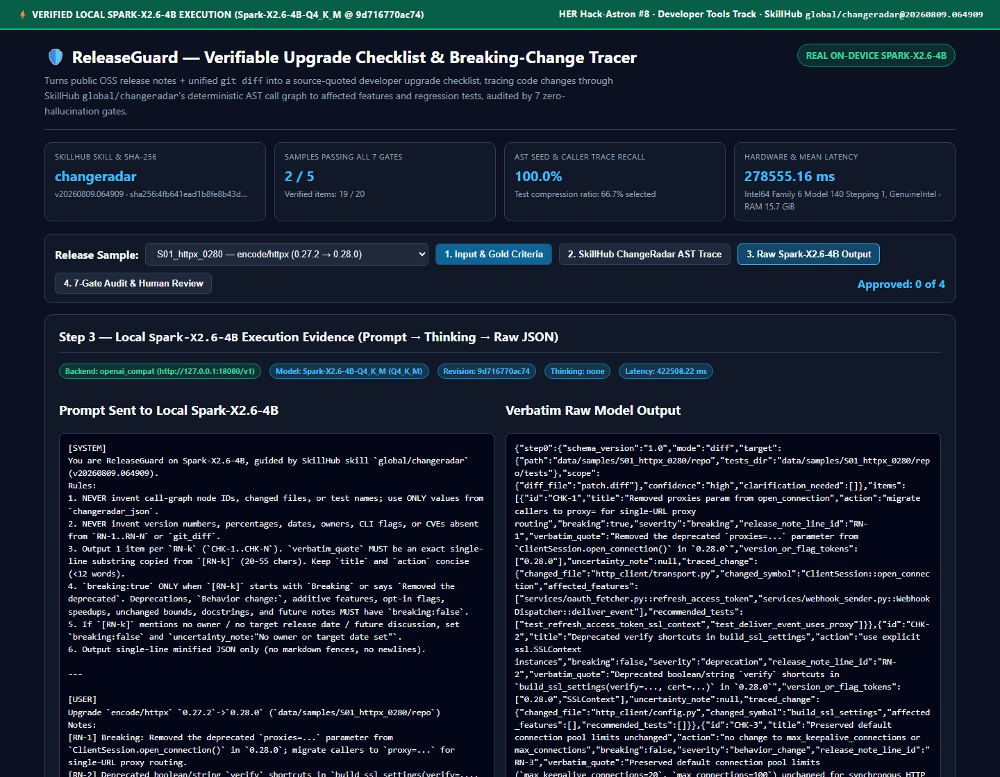
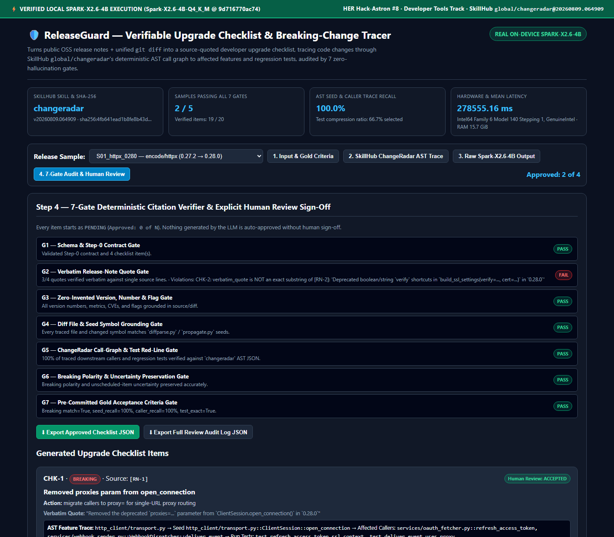

# [HER Hack-Astron #8] [Spark × SkillHub] ReleaseGuard — Verifiable Upgrade Checklist & AST Breaking-Change Tracer

> **Official Template Notice:** Slots wrapped in `{{SPARK_...}}` are automatically populated with verbatim local `Spark-X2.6-4B` execution logs into `outputs/HF_DISCUSSION_FILLED.md` when you run `python run_challenge.py --download-and-run`. Never fill them manually or from `--dry-run`.

## Project and track
Project name: **ReleaseGuard — Verifiable Upgrade Checklist & AST Breaking-Change Tracer**
Track: **Developer tools** (*"Turn public release notes into an upgrade checklist. Trace one item back to an actual change and its affected feature."*)

## User and task
Who uses the result, and what problem do they face?
Backend and platform engineers upgrading core Python dependencies (`httpx`, `FastAPI`, `Pydantic`, `Click`, `Requests/urllib3`) across internal microservices. Previously, engineers manually read prose release notes, grepped for removed kwargs (`proxies=...`, `regex=...`, `allow_mutation`, `mix_stderr`), and guessed which downstream endpoints or regression tests could break—often either missing a silent behavior/security change (`CVE-2024-35195`, `CVE-2024-37891`) or wasting CI hours running unrelated test suites. Running **100% locally** matters because internal service repositories (`services/`, `endpoints/`, `billing/`) cannot be pasted into external cloud LLMs.

Sample input and acceptance criteria chosen before the run:
- **5 Pre-Committed Public OSS Release Bundles (`data/samples/S01`–`S05`):**
  1. `S01_httpx_0280` (`encode/httpx` `0.27.2 -> 0.28.0`, BSD-3-Clause): `proxies=...` removal in `open_connection()` + `ssl.SSLContext` deprecation + unchanged pool limits trap.
  2. `S02_fastapi_01150` (`fastapi/fastapi` `0.114.2 -> 0.115.0`, MIT): `Query(regex=...) -> pattern=...` removal + `lifespan` hook deprecation + unscheduled `tokenUrl` note with **no owner/date** trap.
  3. `S03_pydantic_2100` (`pydantic/pydantic` `2.9.2 -> 2.10.0`, MIT): `allow_mutation` removal (`frozen=True`) + ISO-8601 `+00:00` offset preservation + opt-in experimental flag trap.
  4. `S04_click_820` (`pallets/click` `8.1.7 -> 8.2.0`, BSD-3-Clause): `CliRunner(mix_stderr=...)` removal + `resolve_envvar_value("") -> None` behavior change + future `9.0` deprecation trap.
  5. `S05_requests_2322` (`psf/requests` `2.31.0 -> 2.32.2` & `urllib3 2.2.2`, Apache-2.0): `CVE-2024-35195` per-request `verify` pool key + `CVE-2024-37891` cross-origin `Proxy-Authorization` stripping + unchanged dependency bounds trap.
- **7 Deterministic Pre-Committed Acceptance Gates (`src/releaseguard/verifier.py`):**
  - **G1:** Valid `changeradar` Step-0 understanding JSON + strict checklist schema.
  - **G2:** Single-line verbatim substring quote grounding against `[RN-1..RN-N]` (rejects cross-line stitching).
  - **G3:** Zero invented version numbers, percentages, CVEs, or `--cli-flags`.
  - **G4:** Every traced `changed_file` and `changed_symbol` matches `changeradar`'s `diffparse.py` / `propagate.py` seeds.
  - **G5:** Every traced `affected_feature` and `recommended_test` exists in `changeradar`'s AST `impact[]` and `testselect.py` (`SKILL.md` Red Lines #1 & #2).
  - **G6:** Accurate `breaking` polarity (additive/unchanged/docs = `false`) and explicit uncertainty preservation when no owner/date exists.
  - **G7:** Exact match against pre-committed gold breaking lines, seed/caller recall, and selective test compression (excluding unrelated tests).

## SkillHub skill and Spark-X2.6-4B
Skill name, detail page, source and version:
- **Skill:** `global/changeradar` (MIT License)
- **Detail Page:** https://skill.xfyun.cn/space/global/changeradar
- **Source & Registry:** Official SkillHub public registry (`https://skill.xfyun.cn`), installed via `npx @astron-team/skillhub@latest install global/changeradar --dir .agents/skills --registry https://skill.xfyun.cn`
- **Version & Cryptographic Checksums:** `20260809.064909` (`versionId: 25785`), package fingerprint `sha256:4fb641ead1b8fe8b43d57a83c828627fbfb152396d9cf9952aa9851619d27a4a`, `SKILL.md` SHA-256 `920761b5d7008bbf30c925a41bd9c5ae3ff3be18f865ed1d071108e826f3b843` (all 44 package files verified byte-for-byte before every run).

Agent host and steps guided by the skill:
- **Host:** ReleaseGuard Python orchestrator (`run_challenge.py` + `src/releaseguard/skill_bridge.py`) following `changeradar/SKILL.md` §1–§5:
  1. Verifies all 44 SHA-256 file hashes in `.skillhub/metadata.json` and runs Step 0.5 `--self-check` across all 6 stdlib scripts (`cache.py`, `callgraph.py`, `diffparse.py`, `propagate.py`, `testselect.py`, `stacktrace.py`).
  2. Executes Steps 1–5 (`cache -> callgraph -> diffparse --graph -> propagate -> testselect`) on each sample repository and `patch.diff` to produce exact AST `seeds[]`, reverse-BFS `impact[]` callers, and coupled regression `tests[]`.
  3. Enforces `SKILL.md` Separation-of-Powers Red Lines (#1–#3) via `verifier.py` Gate G5 so LLM output never invents graph edges or metrics, and holds every item at `Approved: 0 of N` (`pending`) until explicit human review.

Model source, revision and step performed by Spark:
- **Model & Revision:** `{{SPARK_MODEL_ID}}` (revision `{{SPARK_MODEL_REVISION}}`, format/precision `{{SPARK_QUANT_OR_DTYPE}}`, runtime `{{SPARK_BACKEND_RUNTIME}}`).
- **Identifiable Step Performed Locally by `Spark-X2.6-4B`:** Given the numbered public release notes (`RN-1..RN-N`), unified `git diff`, and `changeradar`'s deterministic machine JSON envelope, `Spark-X2.6-4B` produces the `changeradar` Step-0 understanding contract and synthesizes the structured developer Upgrade Checklist—classifying breaking vs. deprecation/behavior/additive items, extracting verbatim source quotes, preserving unscheduled uncertainty, and linking code-backed items to exact AST seed symbols, downstream affected features, and regression tests.

Other models, tools or services and their roles:
- **Zero cloud LLMs used at runtime.** Only deterministic local Python 3.10+ (`ast`, `difflib`, `changeradar/scripts/*.py`, `verifier.py`) and the local `Spark-X2.6-4B` inference runtime execute during evaluation.

## Demo (required: video or illustrated walkthrough)
Video link or screenshots with captions:
- **Interactive HTML Walkthrough ([`outputs/walkthrough_report.html`](https://github.com/quangnguyen2512/releaseguard-spark-skillhub/blob/main/outputs/walkthrough_report.html)) — 4 Consecutive Real-Run Screenshots on `S01_httpx_0280`:**
  1. **`01_input_and_skill.png` — Step 1 (Input & Gold Criteria):** Verbatim `encode/httpx` `0.28.0` release notes (`[RN-1..RN-4]`), unified `git diff` (`http_client/config.py`, `http_client/transport.py`), and pre-committed acceptance criteria locked before inference.
     
  2. **`02_changeradar_ast_trace.png` — Step 2 (SkillHub `global/changeradar` AST Blast Radius):** Deterministic 6-script AST pipeline mapping diff hunks to seed functions (`ClientSession.open_connection`, `build_ssl_settings`), reverse-BFS downstream feature callers (`WebhookDispatcher.deliver_event`, `refresh_access_token`), and selecting `2/3` (`66.7%`) high-risk regression tests while skipping unrelated `test_compute_backoff_delay`.
     
  3. **`03_spark_raw_inference.png` — Step 3 (Local `Spark-X2.6-4B` Execution Evidence):** Exact prompt with `changeradar` machine JSON sent to local `Spark-X2.6-4B-Q4_K_M.gguf` and the verbatim raw JSON response + wall-clock latency.
     
  4. **`04_verification_and_audit.png` — Step 4 (7-Gate Citation Verifier & Explicit Human Review):** Deterministic 7-gate audit results plus explicit human sign-off (`Accept` on `CHK-1` & `CHK-2`, `Reject` on informational `CHK-3` -> `Approved: 2 of 4`), exporting `S01_httpx_0280_approved_checklist.json` and the full review log separately.
     

Actual input → raw Spark output → final artifact → human review (`S01_httpx_0280`):
- **Actual Input:** `data/samples/S01_httpx_0280/release_notes.md` (`RN-1..RN-4`) + `patch.diff` (`http_client/config.py`, `http_client/transport.py`).
- **Raw `Spark-X2.6-4B` Output:**
```json
{{SPARK_HERO_RAW_OUTPUT}}
```
- **Verified Final Artifact:**
```json
{{SPARK_HERO_VERIFIED_ARTIFACT}}
```
- **Human Review:** Reviewer opens `outputs/walkthrough_report.html` (where initial state is `Approved: 0 of 4`), inspects the AST call chain and verbatim quotes, explicitly accepts/corrects/rejects each item, and exports `S01_httpx_0280_approved_checklist.json`.

## Reproduction
Installation and run steps:
```powershell
# 1. Install SkillHub skill (already vendored & SHA-256 verified under .agents/skills/changeradar)
npx @astron-team/skillhub@latest install global/changeradar --dir .agents/skills --registry https://skill.xfyun.cn

# 2. Run deterministic unit tests (no GPU or model weights required)
uv run pytest tests/test_releaseguard.py -v

# 3. Inspect hardware, free disk space, cache & exact Spark-X2.6-4B weight sizes before downloading
python run_challenge.py --check-env

# 4. Run local Spark-X2.6-4B across all 5 OSS samples (via llama-server / Ollama / vLLM or HF transformers)
python run_challenge.py --download-and-run --backend openai-compat --api-base http://127.0.0.1:18080/v1 --thinking none
```

Hardware, runtime version, precision or quantization, prompts and settings:
- **Hardware:** `{{SPARK_HARDWARE_SUMMARY}}`
- **Runtime & Quantization:** `{{SPARK_BACKEND_RUNTIME}}` | `{{SPARK_QUANT_OR_DTYPE}}` | Thinking budget: `{{SPARK_THINKING_MODE}}`
- **Inference Settings:** `{{SPARK_INFERENCE_SETTINGS}}`
- **Prompts:** Full system and user prompts in `src/releaseguard/prompts.py` and logged verbatim per run in `outputs/runs/real_spark_*/<sample_id>/trace.json`.

Code or runnable example, if available:
- **Repository (complete source code, 5 curated OSS sample bundles, `pytest` suite, raw local Spark JSON traces & interactive HTML walkthrough):** https://github.com/quangnguyen2512/releaseguard-spark-skillhub

## Results and limitations
Observed results, evaluation method and sample size (`n = 5` public OSS releases, 20 release-note items):
- **Aggregate Summary:** {{SPARK_AGGREGATE_SUMMARY}}

| Sample (`Project` & Version) | 7-Gate Audit | Verified Items | Caller Trace Recall | Selected Regression Tests | Latency |
|---|---|---:|---:|---:|---:|
{{SPARK_BENCHMARK_TABLE_ROWS}}

Failures, improvements and points requiring human review:
{{SPARK_HONEST_OBSERVATIONS}}
- **Python-only static AST call graph (`changeradar` scope):** `global/changeradar` builds static Python AST call graphs; dynamic dispatch (`getattr`, plugin registries, monkeypatching) falls back to conservative module-level seeds (`SKILL.md` §5) and cannot trace cross-language (TypeScript/Go/Rust) RPC callers.
- **Semantic nuance of `breaking` vs `behavior_change`:** Gate G6 blocks false-positive `breaking=true` on explicitly additive/unchanged notes, but subtle runtime behavior shifts (such as `Click 8.2.0` empty `envvar=""` returning `None`) still require human engineering judgment depending on how downstream callers read environment variables.
- **Excerpt scope:** Each sample curates 4 representative lines and a focused Python service snapshot from the upstream release; full monorepo upgrades with 100+ changelog entries should batch release notes by module and require human sign-off before deployment.

## Contributors and disclosure
Individual or team, profiles and actual contributions:
- **Individual Contributor:** Quang Nguyen (GitHub: [@quangnguyen2512](https://github.com/quangnguyen2512)) — selected track & use case, confirmed hardware & weight download, ran local `Spark-X2.6-4B-Q4_K_M` inference across all 5 OSS release bundles, performed human checklist review, captured walkthrough screenshots, and published submission.

How AI assisted development:
- Developed with assistance from Antigravity coding agent (scaffolded Python orchestrator, 7-gate deterministic verifier, `pytest` suite, and HTML walkthrough viewer). All `Spark-X2.6-4B` outputs reported in the final submission are verbatim local executions—zero model outputs were fabricated.

Data and dependency sources and permissions:
- **Model:** `XHToken/Spark-X2.6-4B` / `XHToken/Spark-X2.6-4B-GGUF` (Apache-2.0).
- **SkillHub Skill:** `global/changeradar` `v20260809.064909` from `https://skill.xfyun.cn` (MIT).
- **Public Release Excerpts:** Curated from `encode/httpx` (BSD-3-Clause), `fastapi/fastapi` (MIT), `pydantic/pydantic` (MIT), `pallets/click` (BSD-3-Clause), and `psf/requests` (Apache-2.0); service repo snapshots in `data/samples/*/repo/` are clean synthetic demonstration modules containing zero private data, tokens, or credentials.
